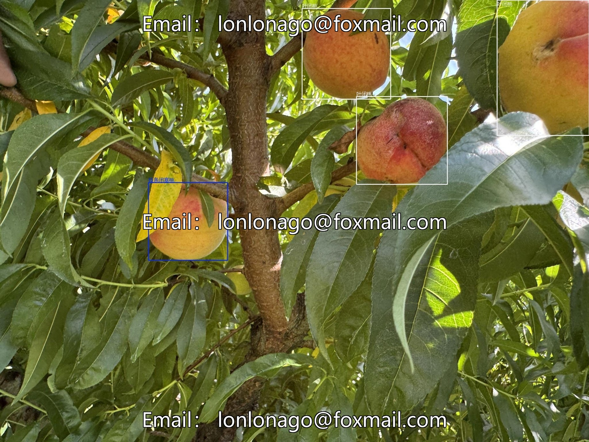
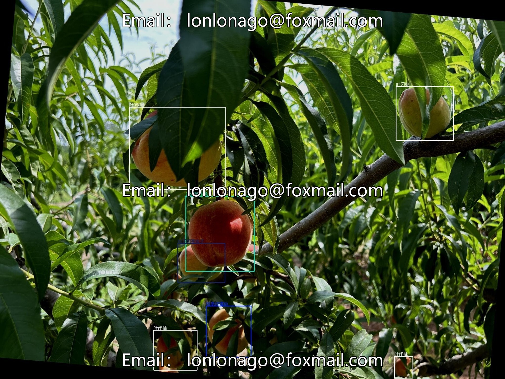
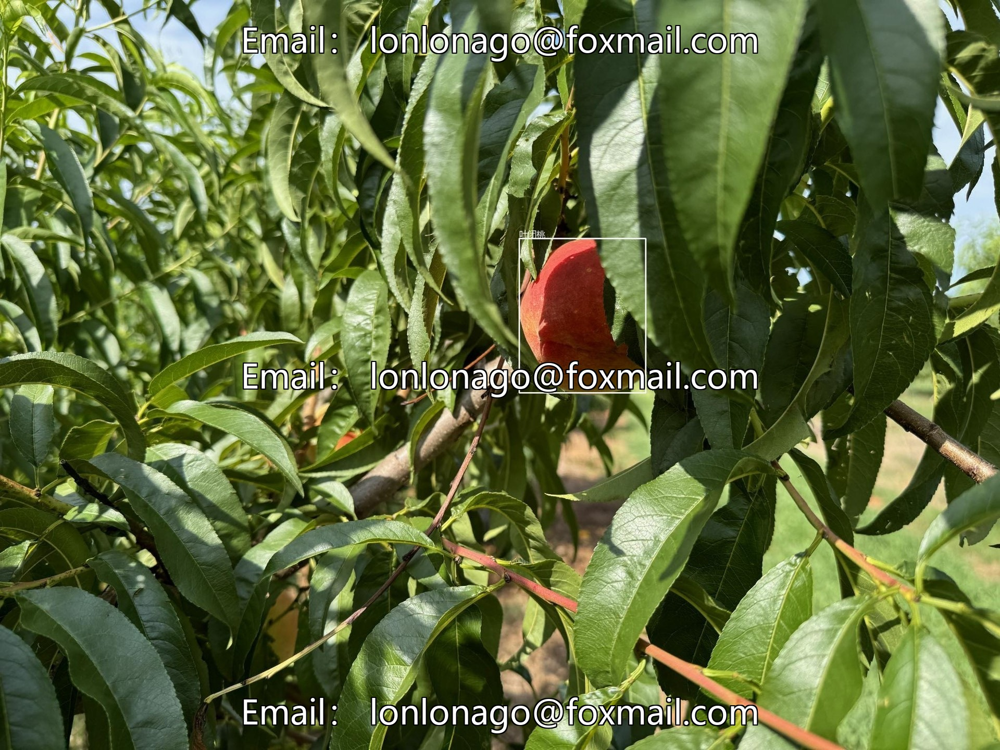
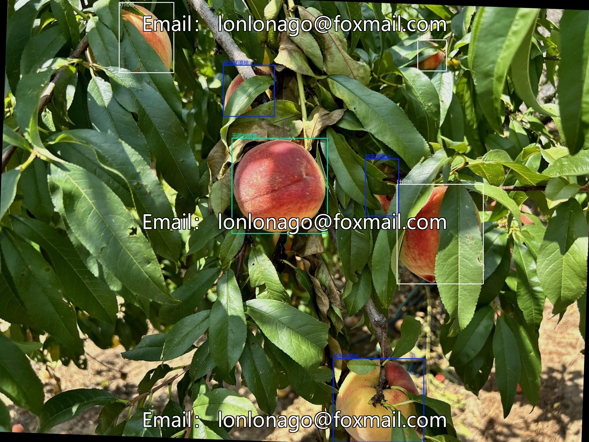

# Deep learning-based YOLO algorithm dataset for judging the maturity of peaches, containing 2200.

## Body

YOLO-based dataset for judging peach ripeness based on deep learning, comprising 2200 real-garden scene images. It covers categories such as unobstructed, tree branch obstruction, ground, leaf obstruction, and between peaches obstruction, labeled in YOLO and PASCAL VOC formats, suitable for agricultural automation, intelligent sorting, etc.

The dataset is moderate in size, with a balanced distribution of categories, supporting model training and validation, thereby enhancing the efficiency of automatic detection and grading of peach maturity. Accurate labeling, close bounding boxes to the fruit, category definition complies with agricultural standards, compatible with mainstream object detection models.

Virtual materials, once sold, are non-refundable.
Interested friends, click "I want" to proceed.

## Images

## Payment

Here is a pay link on Stripe ( https://buy.stripe.com/3cs8yP7sY87d0vu9AB ). Please contact me lonlonago@foxmail.com after funding $89, and I will send you a complete data files , thank you!

